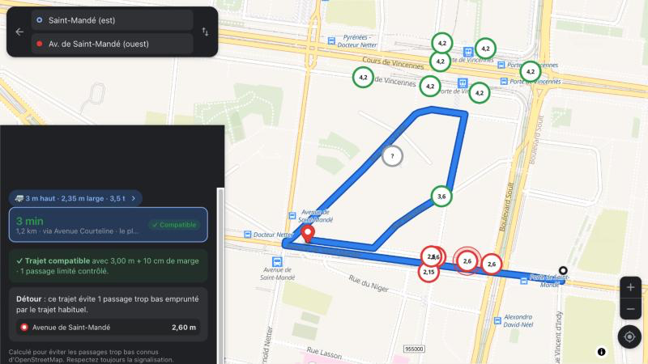

# Gabarit

GPS web pour véhicules hauts : camping-cars, fourgons, camions. Gabarit calcule des itinéraires qui
**évitent automatiquement les ponts, tunnels et portiques trop bas** pour la hauteur saisie, marge
de sécurité comprise, et explique les détours proposés.



Les hauteurs viennent d'OpenStreetMap. Le calcul tourne sur votre propre moteur
[Valhalla](https://github.com/valhalla/valhalla) : aucune API payante, aucune limite d'usage pour
l'itinéraire et les hauteurs.

## Fonctionnalités

- **Véhicule** : profils prêts (voiture, fourgon, camping-car, camion) ou dimensions libres (hauteur,
  largeur, longueur, poids, marge de sécurité). Au-delà de 3,5 t, le profil poids lourd s'applique.
- **Itinéraire compatible** : le moteur calcule avec hauteur + marge, puis chaque trajet est contrôlé
  passage par passage. Un passage trop bas encore présent est exclu et le trajet recalculé.
  Le plus rapide passe en premier, avec jusqu'à deux alternatives (durée, distance, instructions).
- **Explications** : passages évités par rapport au trajet d'une voiture, passages dont la hauteur
  est inconnue sur le parcours, message clair quand aucun trajet n'est possible.
- **Recalcul automatique** quand le véhicule, la hauteur, le départ ou l'arrivée change.
- **Carte des passages bas** colorés selon le véhicule : ne passe pas, sous la marge, passe, inconnu.
- **Ordinateur et téléphone** dans la même page : panneau latéral, ou feuille glissante sur mobile.
  Installable (PWA), démarrage instantané grâce au cache.

## Prérequis

- macOS ou Linux (x86_64 ou arm64)
- Python **3.12 ou plus** pour les outils serveur. [uv](https://docs.astral.sh/uv/) peut l'installer
  pour vous, sans toucher au Python du système.
- `curl`, et environ 1 Go d'espace disque pour l'Île-de-France (45 Go pour la France entière)
- Un navigateur récent, avec accès à Internet pour le fond de carte et la recherche d'adresses

## Installation

```bash
git clone https://github.com/Ablitered/gabarit.git gabarit
cd gabarit

# Environnement Python 3.12 avec le moteur Valhalla et osmium
python3 -m pip install --user uv        # si uv n'est pas déjà installé
uv venv --python 3.12 server/.venv
uv pip install --python server/.venv/bin/python -r requirements.txt
```

Sans uv, n'importe quel Python 3.12+ convient :
`python3.12 -m venv server/.venv && server/.venv/bin/pip install -r requirements.txt`.

### Données

Les données sont générées localement dans `data/` (non versionné). Exemple avec l'Île-de-France
([autres régions sur Geofabrik](https://download.geofabrik.de/europe/france.html)) :

```bash
mkdir -p data/osm
curl -L -o data/osm/ile-de-france-latest.osm.pbf \
  https://download.geofabrik.de/europe/france/ile-de-france-latest.osm.pbf

# Hauteurs (ponts, tunnels, portiques) → data/obstacles   (~2 min)
server/.venv/bin/python tools/build_obstacles.py data/osm/ile-de-france-latest.osm.pbf

# Réseau routier → data/valhalla   (~1 min)
bash tools/build_engine.sh data/osm/ile-de-france-latest.osm.pbf
```

Relancez ces deux commandes avec un fichier plus récent pour mettre les données à jour.

## Lancer

Dans deux terminaux, depuis la racine du dépôt :

```bash
bash server/start_engine.sh        # moteur d'itinéraire sur http://127.0.0.1:8002
```

```bash
python3 -m http.server 8765        # application sur http://localhost:8765
```

Ouvrez http://localhost:8765. Exemple pour vérifier un détour : départ et arrivée de part et d'autre
du pont de l'avenue de Saint-Mandé (Paris 12e, 2,60 m), avec un véhicule de 3 m.

Sur un téléphone, la position et l'installation de l'app demandent une adresse **HTTPS**
(voir Déploiement).

## Configuration

Tout se règle dans [`js/config.js`](js/config.js) :

| Clé | Rôle |
|---|---|
| `valhalla` | URL du moteur (par défaut : même hôte que la page, port 8002) |
| `routeMinIntervalMs` | délai minimum entre deux calculs : `0` avec votre moteur, `1100` avec le serveur public FOSSGIS |
| `obstacleTiles` | dossier des hauteurs générées |
| `overpassFallback`, `overpass` | serveurs Overpass publics, utilisés seulement hors de la zone téléchargée |
| `photon` | recherche d'adresses ([Photon](https://github.com/komoot/photon)) |
| `style` | style du fond de carte ([OpenFreeMap](https://openfreemap.org/)) |

Les scripts acceptent aussi des variables d'environnement : `PY`, `OUT`, `CONCURRENCY`, `LISTEN` pour
`tools/build_engine.sh` ; `PY`, `CONFIG`, `THREADS` pour `server/start_engine.sh` ; `BASE`, `PORT`,
`REGION_URL` pour `deploy/install_vps.sh`. Le projet n'utilise aucune clé d'API ni aucun secret.

## Vérifier

```bash
# Lecture des hauteurs OSM et grille de tuiles (doit rester identique au JavaScript)
server/.venv/bin/python -m unittest discover -s tests

# Moteur démarré : état, puis un trajet pour 3,10 m qui contourne le pont de 2,60 m (~1,19 km)
curl -s http://127.0.0.1:8002/status
curl -s http://127.0.0.1:8002/route -d '{"locations":[{"lat":48.84431,"lon":2.41170},{"lat":48.84470,"lon":2.40622}],"costing":"auto","costing_options":{"auto":{"height":3.1}}}'
```

Il n'y a pas d'étape de compilation : l'application est faite de fichiers statiques (HTML, CSS,
JavaScript sans dépendance à installer). MapLibre GL JS est chargé depuis unpkg, en version fixée.
Pour redessiner les icônes PNG après une modification : `python3 tools/make_icons.py`.

## Déploiement

[`deploy/install_vps.sh`](deploy/install_vps.sh) installe le moteur et les hauteurs pour la France
entière sur un serveur Linux, à côté d'autres sites :

```bash
git clone https://github.com/Ablitered/gabarit.git gabarit && cd gabarit
sudo bash deploy/install_vps.sh
```

Avant toute modification, le script vérifie la mémoire, l'espace disque et le port, puis demande
confirmation. Il travaille dans `/opt/gabarit` sous un utilisateur dédié, ne publie le moteur que
sur `127.0.0.1` et ne modifie ni nginx, ni Apache, ni le pare-feu. À la fin, il affiche le bloc
nginx à ajouter vous-même pour publier l'application en HTTPS.

## Structure

| Chemin | Contenu |
|---|---|
| `index.html`, `css/`, `icons/`, `manifest.webmanifest`, `sw.js` | application (PWA) |
| `js/config.js` | adresses des services |
| `js/services.js` | données : hauteurs, recherche, itinéraires, planificateur |
| `js/app.js` | interface ordinateur et téléphone |
| `legal.html` | confidentialité, conditions d'utilisation, sources |
| `tools/` | extraction des hauteurs, construction du réseau, icônes |
| `server/start_engine.sh` | démarrage du moteur local |
| `deploy/install_vps.sh` | installation sur serveur |
| `tests/` | tests des outils Python |
| `CONFORMITE.md` | conditions des services tiers, règles App Store et Google Play |
| `docs/` | capture d'écran du README |

## Données et licences

Code sous licence [MIT](LICENSE).

Données cartographiques © [contributeurs OpenStreetMap](https://www.openstreetmap.org/copyright),
sous licence ODbL. Les fichiers générés dans `data/` en sont dérivés et restent sous ODbL si vous les
redistribuez. Fond de carte © OpenFreeMap / OpenMapTiles. Moteur Valhalla (MIT), recherche Photon
(Apache 2.0), MapLibre GL JS (BSD-3).

Les hauteurs OpenStreetMap peuvent être absentes ou fausses : l'application aide à préparer un trajet,
elle ne remplace pas la signalisation.
